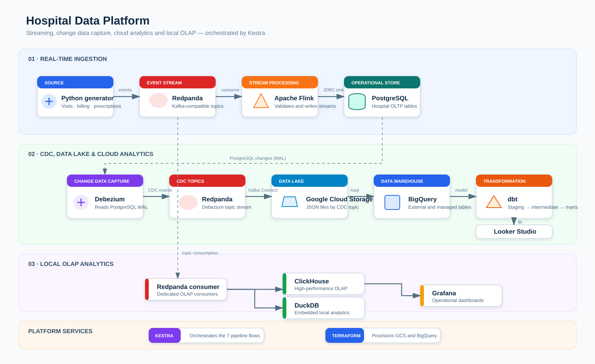
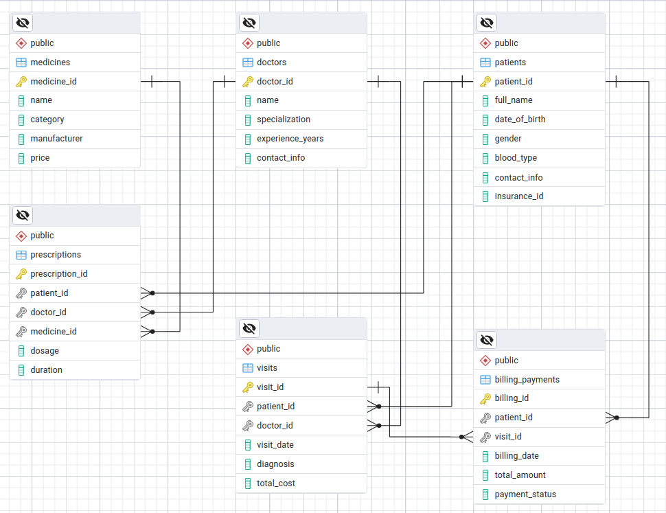
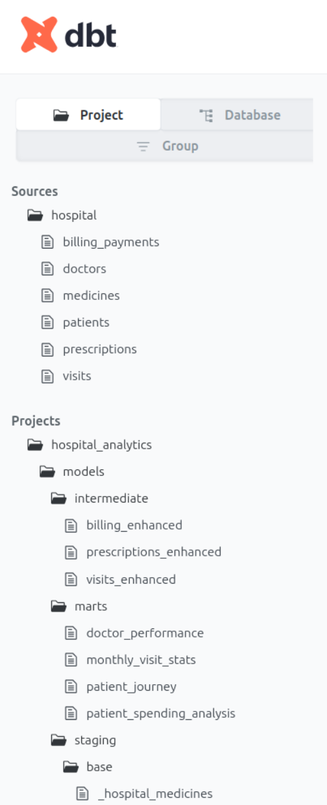
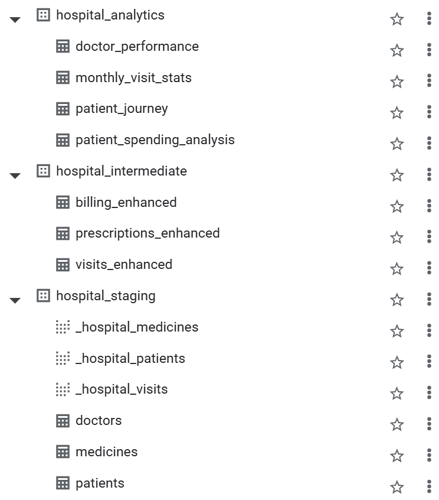
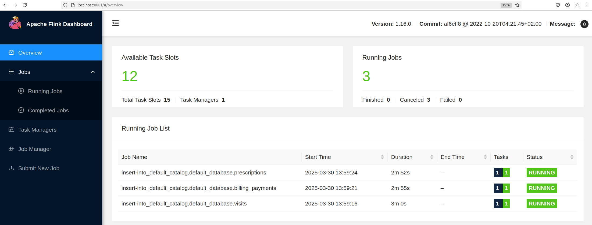

# Hospital Data Platform

> An event-driven hospital analytics platform that combines real-time ingestion, PostgreSQL CDC, a GCS data lake, BigQuery and dbt, with optional local OLAP serving.



## Overview

This repository is a reference implementation of a hospital data platform. It generates operational events, persists them in an OLTP database, captures database changes, and makes the data available to cloud and local analytical consumers.

## Why this project matters

This project demonstrates how a modern healthcare analytics stack can be built using open-source and cloud-native tools:

- Real-time event ingestion from simulated hospital operations
- CDC-based capture of transactional changes from PostgreSQL
- Cloud landing in GCS and BigQuery for analytical consumption
- dbt-driven modelling for trusted, reusable metrics
- Local serving options for faster experimentation and dashboarding
- End-to-end orchestration through Docker Compose and Kestra

The project deliberately separates operational processing from analytical modelling:

- **PostgreSQL** is the system of record for the simulated hospital domain.
- **Redpanda** is the event backbone; it carries both application events and CDC events.
- **Apache Flink** materializes streaming events into the operational store.
- **Debezium and Kafka Connect** capture PostgreSQL changes and land them in Google Cloud Storage (GCS).
- **BigQuery and dbt** provide the governed analytical layer.
- **ClickHouse/DuckDB and Grafana** offer an optional local OLAP path.
- **Kestra** orchestrates the executable pipeline flows.

## Visual project gallery

<div align="center">
  
</div>

<div align="center">
  
  
</div>

<div align="center">
  
  
</div>

These visuals show the architectural flow, the hospital domain model, the dbt transformation lineage, and the operational monitoring view of the streaming pipeline.

## Architecture

| Layer | Technology | Responsibility | Main output |
| --- | --- | --- | --- |
| Event generation | Python | Produces synthetic visits, prescriptions and billing events | Redpanda topics |
| Stream processing | Redpanda, Apache Flink | Consumes live events and writes operational tables | PostgreSQL |
| Change data capture | Debezium, Kafka Connect | Reads the PostgreSQL WAL and emits row-level changes | CDC topics, GCS JSON files |
| Lake and warehouse | GCS, BigQuery | Stores landed CDC files and exposes warehouse tables | Raw analytical tables |
| Transformation | dbt | Applies staging, intermediate and mart models | Analytics marts |
| Serving | Looker Studio, ClickHouse, DuckDB, Grafana | Supports business and operational analytics | Dashboards |
| Control plane | Docker Compose, Kestra | Runs the local stack and orchestrates jobs | Executions and logs |

### End-to-end flow

```text
Python generator
    -> Redpanda application topics
    -> Flink
    -> PostgreSQL operational tables
    -> Debezium (WAL / CDC)
    -> Redpanda CDC topics
    -> Kafka Connect GCS sink
    -> Google Cloud Storage
    -> BigQuery loaders
    -> dbt staging -> intermediate -> marts
    -> Looker Studio

Redpanda application topics -> ClickHouse or DuckDB -> Grafana
```

## Data domain

The hospital domain contains the following core entities:

| Category | Entities |
| --- | --- |
| Dimensions | `doctors`, `patients`, `medicines` |
| Facts / events | `visits`, `prescriptions`, `billing_payments` |

The synthetic producer emits visit, prescription and billing events. The PostgreSQL CDC connector is configured for `public.*`, so any table in the public schema is eligible for capture. The GCS sink is explicitly configured for the six tables listed above.

## Repository map

```text
docker-compose.yml                Local services and networking
connectors/                       Debezium source and GCS sink connector definitions
src/pipeline/                     Producer, Flink job, and BigQuery loading scripts
src/flows/                        Kestra workflow definitions
dbt/models/                       dbt staging, intermediate, and mart models
olap/clickhouse/                  ClickHouse consumer and DDL
olap/duckdb/                      DuckDB consumer and local database assets
images/                           Architecture diagram and project screenshots
```

## Prerequisites

- Docker Desktop with Docker Compose v2
- A Google Cloud project, GCS bucket and BigQuery dataset
- A GCP service-account key named `gcs.json`
- `curl` for connector registration and, optionally, Kestra flow import

Create the GCS bucket and BigQuery dataset in the same region. Configure the project ID and region in `dbt/profiles.yml`; the supplied loaders currently use the `hospital` dataset and the `hospital_datalake` bucket. Update those constants, connector definitions, and dbt profile together if you use different names.

For local development, place the service-account key at `$HOME/gcs.json`. Docker Compose mounts it into Kafka Connect, Flink, dbt and Kestra.

## Runbook

### 1. Start the platform

```bash
docker compose up -d --build
docker compose ps
```

| Service | Address | Purpose |
| --- | --- | --- |
| Kestra | http://localhost:8080 | Workflow orchestration |
| Flink | http://localhost:8081 | Stream-job monitoring |
| AKHQ | http://localhost:8180 | Topic and consumer inspection |
| Kafka Connect / GCS sink | http://localhost:8183 | Sink connector API |
| Debezium Connect | http://localhost:8083 | CDC source connector API |
| pgAdmin | http://localhost:8085 | PostgreSQL administration |
| dbt docs | http://localhost:8087 | dbt documentation endpoint |
| Grafana | http://localhost:3000 | Local OLAP dashboards |

### 2. Initialize the data stores

```bash
docker exec -it project_postgres psql -U postgres -d hospital -f /opt/src/create_tables.sql
docker exec -it project_clickhouse bash -c "clickhouse-client -u streaming --password password -d hospital < /opt/clickhouse/create_tables.sql"
```

### 3. Register CDC and lake connectors

```bash
curl -X POST http://localhost:8083/connectors \
  -H "Content-Type: application/json" \
  -d @connectors/postgres-source.json

curl -X POST http://localhost:8183/connectors \
  -H "Content-Type: application/json" \
  -d @connectors/postgres-debezium-gcs.json

curl http://localhost:8083/connectors/postgres-source/status
curl http://localhost:8183/connectors/postgres-debezium-gcs/status
```

Expected CDC topic names follow the pattern `postgres-source.public.<table>`.

### 4. Import and execute Kestra flows

Import the files in `src/flows/` from the Kestra UI or with the Kestra API. Execute them in the following order.

| Order | Flow | Role |
| ---: | --- | --- |
| 1 | `01_streaming_producer` | Starts the synthetic application-event producer. |
| 2 | `02_topic_flink_postgres` | Starts the Flink Redpanda-to-PostgreSQL job. |
| 3 | `03_dim_gcs_to_bigquery` | Loads dimension snapshots from GCS into BigQuery. |
| 4 | `04_fact_gcs_to_bigquery` | Loads fact snapshots from GCS into BigQuery. |
| 5 | `05_dbt_run` | Runs dbt and generates documentation. |
| Optional | `06_kafka_consumer_clickhouse` | Starts the ClickHouse streaming consumer. |
| Optional | `07_kafka_consumer_duckdb` | Starts the DuckDB streaming consumer. |

Run the dbt flow only after the dimension and fact loaders have completed successfully.

## Verification

Use these checks after deployment or a pipeline change:

```bash
# Application and CDC topics
docker exec -it project_redpanda rpk topic list

# Connector health
curl http://localhost:8083/connectors/postgres-source/status
curl http://localhost:8183/connectors/postgres-debezium-gcs/status

# PostgreSQL row counts
docker exec -it project_postgres psql -U postgres -d hospital -c "SELECT COUNT(*) FROM visits;"
```

Then verify that files are written under `gs://<bucket>/topics/`, that the BigQuery loads finish successfully, and that dbt reports successful model builds. Use Kestra for execution logs and retries; use the Flink dashboard for job lifecycle and throughput.

## dbt modelling contract

The dbt project follows a layered convention:

```text
sources -> staging/base -> staging/refined -> intermediate -> marts
```

The current marts cover doctor performance, patient spending analysis, patient journey, and monthly visit statistics. The intent is to keep source normalization, reusable business logic, and dashboard-facing metrics in separate layers.

## Operational characteristics and current limitations

This is a learning/reference implementation, not a production-ready healthcare system. The following behaviours are intentional or currently present in the codebase:

- The Python producer emits synthetic data continuously; it is not connected to a real clinical source system.
- The BigQuery loader scripts enumerate files in GCS and use `WRITE_TRUNCATE`. They build full-refresh snapshots, not idempotent incremental loads.
- GCS records are JSON and are flushed frequently for demonstration. Columnar formats, partitioning and compaction would be preferable at scale.
- The CDC configuration unwraps Debezium envelopes before landing records. If auditability of operations is required, retain operation metadata and tombstones in a dedicated raw layer.
- Kestra flows invoke commands in Docker containers. A production control plane should use managed execution, durable logs, alerts, retries and explicit dependency/SLA policies.
- ClickHouse and DuckDB are alternative local serving paths; they are optional and should not both be treated as the canonical warehouse.

## Security and production hardening

Do not use the development settings in `docker-compose.yml` in a shared or production environment. At minimum:

- Store service-account keys and database credentials in a secret manager; never commit them.
- Replace default passwords, scope IAM privileges narrowly, and rotate credentials.
- Encrypt data in transit and at rest; define retention, backup and recovery policies.
- Enforce network segmentation and authenticated access to Kafka/Redpanda, PostgreSQL, Kafka Connect, Grafana and orchestration endpoints.
- Apply data classification, access logging, masking or tokenisation, and regulatory controls appropriate for healthcare data in your jurisdiction.
- Add schema compatibility checks, data-quality tests, lineage, alerting and observability before relying on analytics outputs.

## Optional batch path

`src/pipeline/pyspark_extract_upload_gcs.py` demonstrates a separate PySpark extraction path from PostgreSQL to GCS. Use it only in a controlled window: direct batch reads against an OLTP database can compete with transactional workloads. In production, prefer a read replica or an analytical replica.

## Technology stack

PostgreSQL, Redpanda, Apache Flink, Debezium, Kafka Connect, Google Cloud Storage, BigQuery, dbt, Kestra, Docker Compose, ClickHouse, DuckDB, Grafana, Looker Studio and PySpark.
